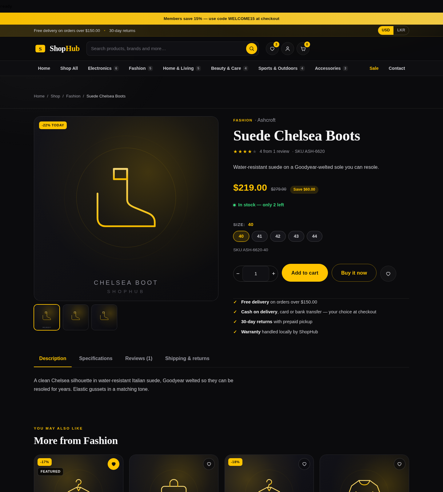
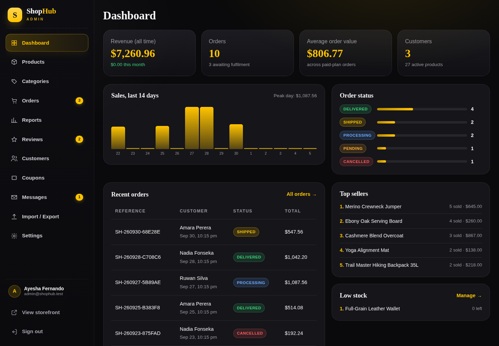
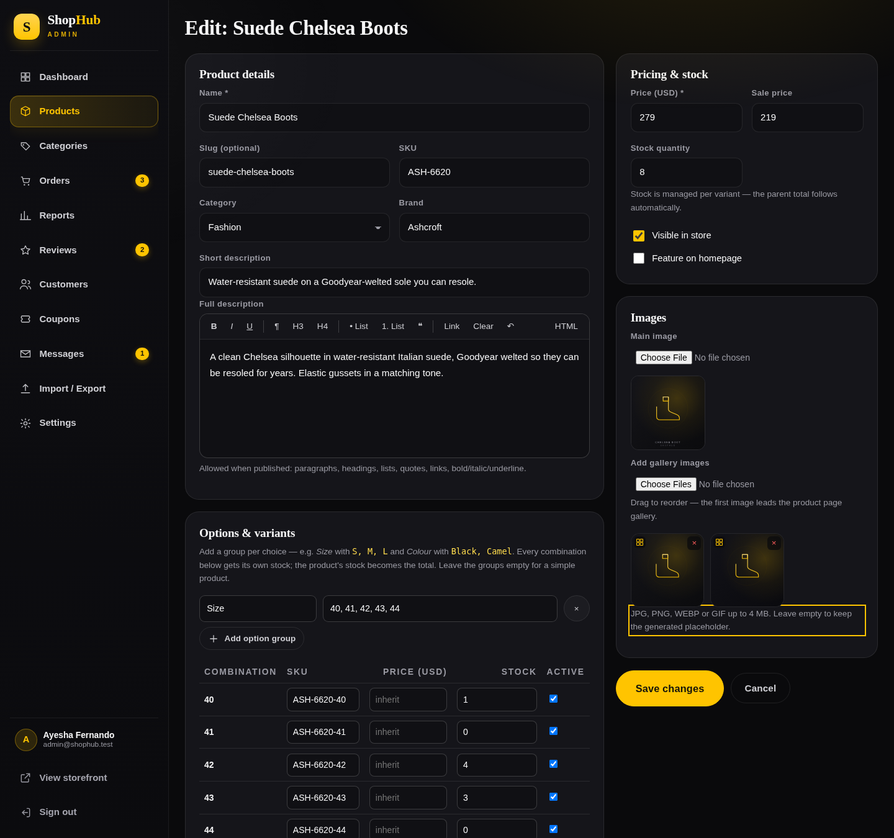
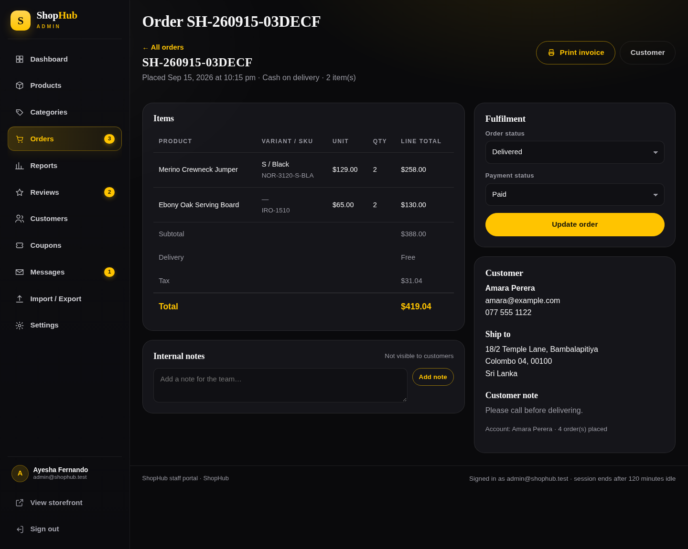
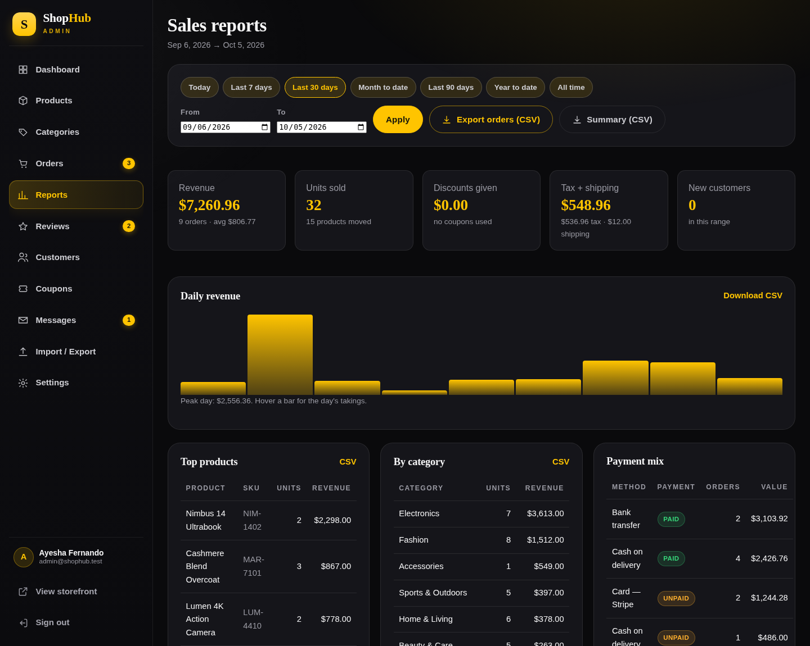

<div align="center">


# ShopHub

**A complete e-commerce platform in black & amber — PHP + MySQL, no frameworks, no build step.**

Two separate applications: a customer storefront and a staff back office.

[**🛒 Live demo — storefront**](https://YOUR-DOMAIN.example/shophub/) &nbsp;·&nbsp; [**🔐 Live demo — staff portal**](https://YOUR-DOMAIN.example/shophub-admin/)

`admin@shophub.test` / `admin123` — staff portal &nbsp;|&nbsp; `amara@example.com` / `password123` — customer

</div>

---

## What it is

| Folder | Who it is for | Entry point |
|---|---|---|
| `shophub/` | Customers — browse, buy, manage their account | `/shophub/` |
| `shophub-admin/` | Staff — catalogue, orders, reports, settings | `/shophub-admin/` |

The storefront carries **no admin login and no link to the portal**. The staff app has its own
sign-in, its own session cookie and a `noindex` header. Both run on one database.

## Features

**Storefront** — editorial homepage, catalogue with category / brand / price / stock filters and 6
sort modes, product pages with a gallery, size–colour variant picker (live price + per-variant
stock), specs, reviews, session cart, wishlist, coupons, guest **and** member checkout, order
confirmation, account dashboard with order history and addresses, contact form, and a
USD ⇄ LKR currency switch.

**Staff portal** — dashboard with revenue, 14-day chart and low-stock alerts; product editor with a
**WYSIWYG** description, specs, **multi-image drag-to-reorder gallery** and a full **variant editor**
(any option groups → every combination gets its own SKU, price and stock); CRUD for categories,
coupons and reviews; order management with **milestone emails** (processing / shipped / delivered /
cancelled / refunded), internal notes and a printable invoice; **sales reports by date range** with
CSV export for every table; **CSV import/export** for products (including variants), orders,
customers and reviews; settings for currency, shipping, tax, payment methods, gateway keys, mail
transport and feature switches.

**Payments** — cash on delivery, bank transfer, **Stripe** (hosted Checkout) and **PayHere**
(Sri Lanka), selected per store; webhooks are signature-verified before an order is marked paid.

**Accounts & security** — email verification and password reset with hashed single-use tokens,
per-account login throttling stored in the database, CSRF on every state-changing request, prepared
statements throughout, stock re-checked inside a transaction at checkout, upload validation, and
separate session cookies per app.

## Screenshots

| Storefront | Product & variants |
|---|---|
|  |  |

| Dashboard | Product editor |
|---|---|
|  |  |

| Orders | Reports |
|---|---|
|  |  |

## Requirements

* **PHP 8.1+** (tested on 8.4) — `pdo_mysql` (or `pdo_sqlite`), `mbstring`, `fileinfo`, `json`, `curl` (Stripe only)
* **MySQL / MariaDB**
* Apache with `mod_rewrite` optional — `.htaccess` already protects `storage/` and `includes/`
* No Composer, no npm, no build step

## Install (XAMPP or any cPanel host)

1. Copy both folders into the web root, side by side:

   ```
   htdocs/
   ├── shophub/
   └── shophub-admin/
   ```

   One folder instead? `htdocs/shophub/{shophub, shophub-admin}` also works with no configuration.
2. Create an empty MySQL database named `shophub` (`utf8mb4`).
3. If your credentials differ from `root` / no password, create `shophub/includes/config.local.php`:

   ```php
   <?php
   return ['db' => ['host' => 'localhost', 'name' => 'shophub', 'user' => 'your_user', 'pass' => 'your_pass']];
   ```
4. Open `http://localhost/shophub/install.php` → tick the box → **Run installation**.
   It creates 20 tables and loads the demo catalogue (27 products, 21 variants, 10 orders, reviews).
5. Shop: `http://localhost/shophub/` · Portal: `http://localhost/shophub-admin/`
6. **Delete `install.php` from the server once it works.**

Command line: `php install.php` · rebuild: `php install.php --fresh` · schema only: `php install.php --migrate`.

## Demo mode without MySQL

```bash
SHOPHUB_DB_DRIVER=sqlite php install.php --fresh
SHOPHUB_DB_DRIVER=sqlite php -S localhost:8080 shophub/router.php
```

Same code path, a file database instead — handy for a quick look. Both apps support either driver.

## Deploying this to a live host

See [`PUBLISH-AND-DEPLOY.md`](PUBLISH-AND-DEPLOY.md) — it covers hosting choices, the cPanel steps,
the settings that must be changed before inviting the public (delete `install.php`, change the staff
password, real SMTP, gateway keys) and how to keep secrets out of Git.

## Tech

PHP 8 · MySQL / MariaDB (SQLite for the demo) · vanilla JavaScript · hand-written CSS · inline SVG
artwork · no external CDN, so the app runs fully offline.

## Licence

Choose one and keep this section honest:

* **Portfolio / open source:** `MIT` — add a `LICENSE` file.
* **Proprietary:** `© 2026 <your name>. All rights reserved. Source published for viewing only.`
* **No reuse:** keep the repository private.
